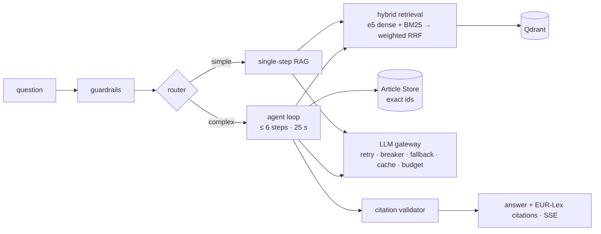

# RegLens

**Agentic RAG over the EU AI Act & GDPR with verifiable citations — evaluated, observable, deployable.**

  

Ask in English or Italian (*"Is a chatbot that screens job applicants high-risk?"*). RegLens retrieves from the official texts, answers **only** from what it retrieved, cites article / paragraph / point ids with deep links to EUR-Lex, and says *"not in the corpus"* instead of guessing. Not legal advice.

> **Status (2026-11-20):** the code for retrieval, agent, API, observability and CI/CD is complete and tested (285 unit tests). **All metrics below are preliminary**: they are on the *dev* split of a 150-query benchmark that has not yet been human-reviewed. The held-out *test* split has never been run (it will be run once, at the end). Live URL: pending the hosting decision (see [ADR-0001](docs/adr/0001-stack-and-free-tiers.md)).

## Results at a glance (dev, preliminary)

Retrieval, article-level, `reglens_v1@cdebd13e` dev split, n = 83 queries with a retrieval target, 95% bootstrap CIs:

| Configuration | recall@5 | MRR@10 | nDCG@10 | Run |
|---|---|---|---|---|
| BM25 baseline | 0.565 [0.47–0.66] | 0.525 [0.44–0.61] | 0.540 [0.47–0.61] | [json](evals/results/20261120-0844_f8c77a2c5c4f_8498a86c_dev.json) |
| Dense e5-large baseline | 0.747 [0.66–0.83] | 0.657 [0.58–0.73] | 0.672 [0.60–0.74] | [json](evals/results/20261120-0844_f8c77a2c5c4f_d1e4efd9_dev.json) |
| **Serving config** (hybrid, units, hierarchy, recitals excluded) | **0.868 [0.81–0.93]** | **0.858** | **0.846** | [json](evals/results/20261120-0939_28c7d8af9d18_a8537e7c_dev.json) |

- **Brief targets:** the serving configuration meets the recall@5 threshold (≥ 0.85) and the MRR@10 target (≥ 0.80) on dev. Retrieval latency is p50 79 ms / p95 103 ms on a laptop CPU (embedded Qdrant, development numbers).
- **Sanity check on a public benchmark:** our BM25 on BEIR SciFact gives nDCG@10 0.6886, against the 0.665 published in the BEIR paper (Table 2). That is 0.024 above, just outside the ±0.02 tolerance. Diagnostic runs attribute the gap to preprocessing (without stemming: 0.6617), not to the scoring code ([runs](evals/results/)).
- **Generation metrics** (faithfulness, correctness, citation precision, refusal accuracy, judge κ): the evaluation harness and judge are implemented and tested; real runs need free-tier API keys and 40 human labels for judge calibration.

## Architecture



1. **Ingestion:** official XHTML from the EU Publications Office (AI Act consolidated 27.07.2026 incl. the Digital Omnibus; GDPR), parsed into articles, paragraphs, points, recitals and annexes with canonical ids identical in EN and IT.
2. **Retrieval:** hybrid dense (multilingual-e5-large) + BM25 (per-language stemming), fused with weighted RRF over paragraph / definition / annex-point units.
3. **Routing:** simple questions → one LLM call; complex ones → a from-scratch tool-calling agent (`search`, `get_article`, `get_definition`, `follow_references`, `final_answer`).
4. **Citation checks:** every citation must exist, must have been retrieved in this conversation, and any quote must appear verbatim in the source. One repair round, then refusal.
5. **Observability:** every stage is an OpenTelemetry span (→ Langfuse) with latency, tokens, shadow cost and versions; metrics on `/metrics` (→ Grafana).

More: [docs/architecture.md](docs/architecture.md).

## Quickstart

```bash
make setup                 # uv sync + pre-commit
make ingest                # download (Cellar), parse, chunk -> data/processed/ (also committed)
QDRANT_URL=path:qdrant_local make index STRATEGY=units ENRICH=hierarchy   # ~16 min on CPU
QDRANT_URL=path:qdrant_local make serve                                    # http://localhost:8000
```

```bash
curl -s localhost:8000/v1/ask -H "X-API-Key: $REGLENS_API_KEY" -H 'Content-Type: application/json' \
  -d '{"question": "Entro quanto va notificato un data breach?"}' | jq '.answer, .citations'
```

Without LLM keys the API runs in **sources-only** mode (retrieved passages with links). Add `GROQ_API_KEY` / `GEMINI_API_KEY` to `.env` for generated answers.

## Evaluation methodology

- **Benchmark:** 150 queries (100 dev / 50 test, stratified), EN/IT, covering single-hop, multi-hop, definitional, scenario, unanswerable, adversarial and ambiguous questions. Every gold id is verified against the corpus; **human review of 100% of the records is pending**.
- **Retrieval metrics:** recall@k, MRR, nDCG at article level, with 1000-resample bootstrap CIs and paired bootstrap for comparisons (`make compare`).
- **Generation metrics:**
  - LLM judge from a different model family than the generator, with versioned prompts, to be calibrated against human labels (Cohen's κ);
  - deterministic metrics: citation precision and validity, refusal accuracy, injection success, tool-call validity.
- **Test-split protection:** the test split is refused without `--final`, and every access is logged.

Details: [docs/eval-methodology.md](docs/eval-methodology.md).

## Ablations

Sixteen configurations: [docs/ablation.md](docs/ablation.md). What moved the numbers (paired bootstrap on dev):

| Change | Δ recall@5 | Evidence |
|---|---|---|
| Hierarchical prefix ("GDPR > Capo III > Art. 17 > par. 1") | MRR +0.09 vs plain hybrid | [ADR-0002](docs/adr/0002-chunking-units.md) |
| Exclude recitals from retrieval (they took 44% of top-5 slots) | +0.078 | [ADR-0003](docs/adr/0003-hybrid-retrieval-no-reranker.md) |
| One chunk per legal definition | +0.036 (p = 0.047) | ADR-0002 |
| Cross-encoder reranker (bge-reranker-v2-m3) | **−0.030**, p50 latency 67 ms → 4480 ms on CPU, rejected | ADR-0003 |
| Structure-blind fixed 500-token windows | −0.065 vs paragraph | ADR-0002 |

## Design decisions & trade-offs
- **Corpus:** consolidated AI Act text with the July 2026 amendments, recitals from the Official Journal; EUR-Lex HTML is behind a WAF, so sources come from the Cellar API with sha256 pinning. See [data/README.md](data/README.md).
- **Own OpenAI-compatible LLM gateway** instead of LiteLLM, after two 2026 PyPI supply-chain compromises of LiteLLM ([ADR-0005](docs/adr/0005-own-llm-gateway-instead-of-litellm.md)).
- **Agent loop written from scratch** (no framework): explicit state, limits on steps, time and tokens, one citation repair. See `src/reglens/agent/loop.py`.
- **Embedded Qdrant index shipped inside the image** (`INDEX_MODE=local_snapshot`, 36 MB), so the demo does not depend on a free cluster that suspends after a week of inactivity ([ADR-0004](docs/adr/0004-embedded-qdrant-local-mode.md)).
- **Free tiers verified with sources and dates;** hosting is still open ([ADR-0001](docs/adr/0001-stack-and-free-tiers.md)).

## Production readiness
- **Graceful degradation:**
  - reranker failure → fused order;
  - LLM down, rate-limited or over the daily budget → sources-only answers;
  - index unreachable → `503` with `Retry-After`.

  All of these are covered by fault-injection tests.
- **API:** RFC 7807 errors, request-id propagation, constant-time API-key auth, token-bucket limits per key / IP / public UI, CSP and security headers, PII masking in logs and traces.
- **Observability and alerting:** 14-panel Grafana dashboard ([json](dashboards/grafana_reglens.json)); 6 alert rules plus uptime checks, each with a [runbook](docs/runbook.md) entry.
- **CI/CD:**
  - lint, mypy --strict, tests, integration tests against a Qdrant service container;
  - **smoke-eval regression gate** (fails if recall@5 drops by more than 0.03 vs the baseline, about 4 s, no secrets);
  - nightly full eval, security scans (pip-audit, gitleaks, trivy), GHCR image, optional HF Space deploy and live smoke test.
- **Local load test** (sources-only mode, 5 users × 30 s, laptop): 17 req/s, p95 367 ms, 0 errors; at the default limit, rate limiting answers 429 to the excess ([json](evals/results/20261120-0945_28c7d8af9d18_loadtest-local.json)).

## Cost
- **Real cost:** runs on free tiers, ≈ $0 per month (hosting may add $9 per month, see ADR-0001).
- **Shadow cost:** each LLM call is priced at the paid list price with a dated source ([pricing.py](src/reglens/llm/pricing.py)). Per-query figures will be reported from the first e2e run.

## Limitations & failure analysis (current)
- **Scenario questions** are the weakest retrieval category (recall@5 0.68): case descriptions use different words from the statute. Next experiment: LLM query rewriting.
- **Adversarial items** (n = 6 with a retrieval target): recall@5 0.67; the real test is generation and injection resistance, which needs the e2e run.
- **GDPR corrigenda** are not yet integrated (2016 OJ text).
- **Point ids:** Annex sections and repeated point labels are merged under the first id.
- **Latency numbers** come from embedded Qdrant on a laptop; production figures come after deployment.

The full 20-error failure analysis will be done on reviewed data (`docs/failure-analysis.md`).

## What I'd do in production
- Evaluation with domain experts (lawyers, DPOs).
- Incremental updates when EUR-Lex publishes a new consolidated version.
- Online A/B tests of retrieval configurations, red-teaming in CI.
- GPU-served reranker and generator.
- User authentication and multi-tenancy.
- Formal SLOs.

## Repo map, licences, data
- **`src/reglens/`:**
  - `ingestion/`, `retrieval/`, `agent/`, `llm/`, `api/`, `observability/`, `web/`;
- **`evals/`:** datasets, metrics, judge, runners, results;
- **`docs/`:** ADRs, methodology, runbook, architecture;
- **`.github/workflows/`:** CI/CD.

**Licences:**
- Code: MIT.
- Legal texts: © European Union, EUR-Lex / Publications Office, reuse under Commission Decision 2011/833/EU (see [data/README.md](data/README.md)).
- Models:
  - multilingual-e5-large (MIT);
  - Qdrant/bm25 (Apache-2.0);
  - bge-reranker-v2-m3 (Apache-2.0).
