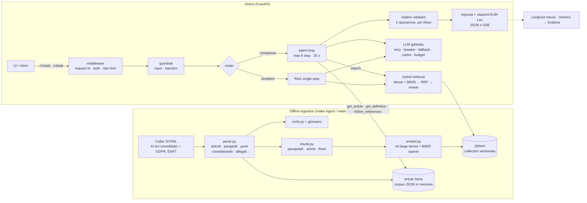

# Architecture

Il flusso in cinque passi:
1. La domanda passa da middleware e guardrail.
2. Il router manda le domande semplici al RAG a passo singolo e quelle complesse all'agente.
3. Il retrieval è ibrido: e5 più BM25, fusi con RRF e riordinati dal reranker se attivo, al livello di paragrafo. Gli ID canonici e i link EUR-Lex viaggiano nel payload.
4. L'LLM risponde solo tramite `final_answer`: le citazioni devono esistere, essere state recuperate e, se c'è una citazione testuale, il testo deve comparire nella fonte. È prevista una sola riparazione, poi il sistema rifiuta.
5. Ogni stadio è uno span con latenza, token, costo e versioni.

## Moduli
| Modulo | Ruolo |
|---|---|
| `ingestion/` | fetch (Cellar), parse, xrefs, glossary, chunk, enrich, embed, index, pipeline, manifest |
| `retrieval/` | dense, sparse, fusion (RRF), rerank, pipeline, factory, store (Article Store), lang |
| `agent/` | tools (allowlist e schemi), loop, state, router, citations, guardrails, prompts versionati |
| `llm/` | client OpenAI-compatibile, fallback e circuit breaker, cache e replay, pricing, budget |
| `api/` | FastAPI, SSE, RFC 7807, auth, rate limit, degradazione |
| `observability/` | structlog con masking PII, OpenTelemetry → Langfuse, metriche |
| `evals/` | dataset, metriche, bootstrap, giudice e calibrazione, run_eval, e2e, compare, report, smoke gate |

## Decisioni
Vedi `docs/adr/`:
- **0001:** stack e free tier;
- **0002:** chunking (strategie di suddivisione del testo);
- **0003:** retrieval ibrido e reranker;
- **0004:** Qdrant embedded e snapshot;
- **0005:** gateway LLM proprio al posto di LiteLLM.
